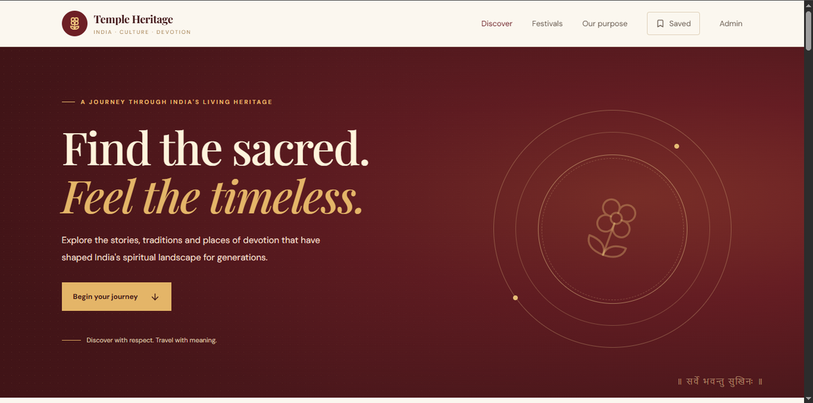
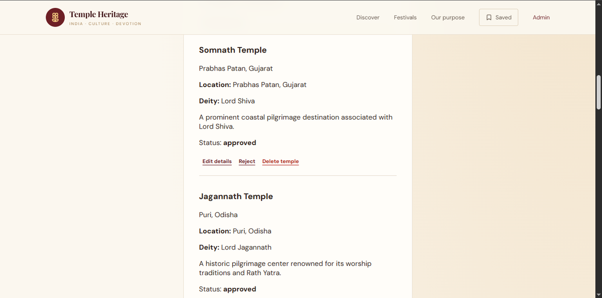

# 🛕 India Temple Heritage & Pilgrimage Portal

A full-stack web application designed to help visitors discover India's temples, explore their cultural heritage, and access useful pilgrimage information through a modern, responsive interface.

## 🌐 Live Demo

- **Website:** https://india-temple-heritage-portal-one.vercel.app/
- **Admin Panel:** https://india-temple-heritage-portal-one.vercel.app/admin
- **Backend API:** https://temple-heritage-api.onrender.com/api/temples

## ✨ Features

- **Temple Directory:** Browse temple information from different regions of India.
- **Search and Filters:** Find temples using search, state, and category filters.
- **Temple Details:** Explore descriptions, historical information, and visitor guidance.
- **Saved Temples:** Save favorite temples for quick access in the browser.
- **Admin Panel:** Manage temple records through administrative controls.
- **Content Management:** Add, edit, and delete temple records.
- **Approval Workflow:** Manage temple publication status.
- **Responsive UI:** Browse the portal on desktop and mobile devices.
- **REST API:** Retrieve approved temple records from the PostgreSQL database.

## 🧰 Tech Stack

| Layer | Technologies |
|---|---|
| Frontend | React, Vite, JavaScript, CSS |
| Backend | Node.js, Express.js |
| Database | PostgreSQL, Neon |
| Authentication | JSON Web Tokens (JWT) |
| Validation | Zod |
| Image Uploads | Cloudinary, Multer |
| Frontend Deployment | Vercel |
| Backend Deployment | Render |
| Version Control | Git and GitHub |

## 🏗️ Architecture

The frontend communicates with the Express backend through REST API endpoints. The backend retrieves and manages temple records in PostgreSQL, while the admin interface provides protected content-management operations.

## 🔌 API

| Method | Endpoint | Purpose |
|---|---|---|
| GET | `/api/temples` | Retrieve approved temples |
| GET | `/api/temples/:slug` | Retrieve a temple by slug |
| POST | `/api/admin/login` | Authenticate an administrator |
| GET | `/api/admin/temples` | List temple records |
| POST | `/api/admin/temples` | Add a temple |
| PUT | `/api/admin/temples/:id` | Update a temple |
| PATCH | `/api/admin/temples/:id/status` | Update publication status |
| DELETE | `/api/admin/temples/:id` | Delete a temple |

Administrative endpoints require authentication where applicable.

## 🚀 Run Locally

### Prerequisites

- Node.js and npm
- PostgreSQL database
- Git

### 1. Clone the repository

```bash
git clone https://github.com/PDubey-tech26/india-temple-heritage-portal.git
cd india-temple-heritage-portal
```

### 2. Install frontend dependencies

```bash
npm install
```

Configure the frontend API URL in its environment file:

```env
VITE_API_URL=http://localhost:4000/api
```

Start the frontend using the development script configured in `package.json`.

### 3. Configure the backend

Open the `server` directory and install its dependencies:

```bash
cd server
npm install
```

Create or update `server/.env` with your own database connection and required backend settings. Never commit real credentials.

Example configuration keys:

```env
PORT=4000
DATABASE_URL=your_postgresql_connection_string
PGSSL=true
JWT_SECRET=your_secure_random_secret
CLIENT_ORIGIN=http://localhost:5173
```

Configure any additional variables required by your backend, including Cloudinary settings when image uploads are enabled.

### 4. Start the backend

From the `server` directory:

```bash
node src/index.js
```

Ensure the database schema has been applied before using the API.

## 🔐 Security Notes

- Keep `.env` files and database credentials out of version control.
- Use a strong, private JWT secret.
- Protect administrative routes with authentication.
- Do not publish administrator passwords, API keys, or database URLs.
## 📸 Screenshots

### Homepage


### Admin Panel

## 📌 Project Status

The application is deployed with a working frontend, backend API, PostgreSQL integration, and administrative temple-management interface.

## 👨‍💻 Author

**Priyanshu Dubey**

- GitHub: https://github.com/PDubey-tech26
- LinkedIn: https://www.linkedin.com/in/priyanshu-dubey-375359333
